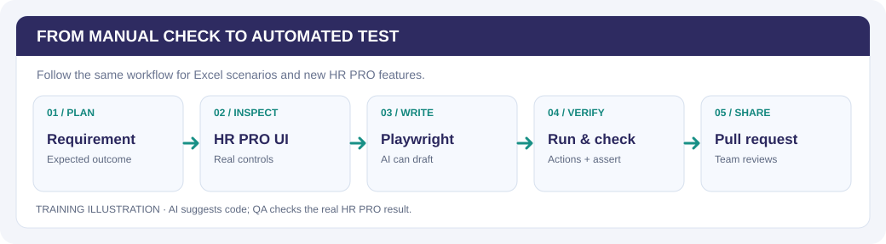

<p align="left"></p>

# HR PRO Automated Testing

This project uses **Playwright** to automatically check HR PRO in a browser. It can do the same steps a manual tester does—open pages, enter test data, click buttons—and then **check whether the result is correct**.

**[Open the HR PRO QA Guide](https://hr-pro-automation.netlify.app)** · **[Create a test with AI](https://hr-pro-automation.netlify.app/#ai)**

### Quick links

| Get started | Learn the tools | Create &amp; share |
| :--- | :--- | :--- |
| [**Project folders**](https://hr-pro-automation.netlify.app/#structure) · [Install](https://hr-pro-automation.netlify.app/#install) | [**Verify a result**](https://hr-pro-automation.netlify.app/#verify) | [**New test walkthrough**](https://hr-pro-automation.netlify.app/#create) |
| [**Ways to run tests**](https://hr-pro-automation.netlify.app/#run-options) | [**Playwright syntax**](https://hr-pro-automation.netlify.app/#syntax) | [**AI Help + copyable prompt**](https://hr-pro-automation.netlify.app/#ai) |
| [**UI Mode guide**](https://playwright.dev/docs/test-ui-mode) | [**Locators**](https://playwright.dev/docs/locators) | [**GitHub workflow**](https://hr-pro-automation.netlify.app/#github) |



*Illustrated workflow: start with a requirement, inspect the real UI, write assertions, verify results, and request review.*

## Where are the tests?

| Folder or file | What it's for |
| --- | --- |
| [`tests/smoke/`](tests/smoke/) | **Start here.** Login and navigation checks, such as `SMOKE-018` in [navigation.spec.ts](tests/smoke/navigation.spec.ts). |
| [`tests/regression/setup/`](tests/regression/setup/) | HR PRO Setup feature checks—Departments, Employees, allowances and more. Put **new Setup tests** here. |
| [`tests/infrastructure/`](tests/infrastructure/) | Advanced inspection scripts, **not routine regression tests**. |
| [`playwright/fixtures/`](playwright/fixtures/) | Reusable login/test setup. |
| [`playwright/pages/`](playwright/pages/) | Reusable actions and element locators. |
| [`package.json`](package.json) / [`playwright.config.ts`](playwright.config.ts) | Available commands, target URL and Playwright settings. |

**New test?** Create `tests/regression/setup/my-feature.spec.ts` for a Setup feature. [See the visual folder guide](https://hr-pro-automation.netlify.app/#structure).

## Start here — run your first test

Install [Git](https://git-scm.com/), [Node.js](https://nodejs.org/), and [VS Code](https://code.visualstudio.com/). Ask for GitHub repository access and an approved HR PRO test environment.

Open VS Code → **Terminal → New Terminal**, then enter:

```powershell
git clone https://github.com/nitsuwa/hr-pro-automation.git
cd hr-pro-automation
npm ci
npx playwright install chromium
npm run test:ui:smoke
```

In Playwright UI Mode, open `navigation.spec.ts`, find **SMOKE-018 (Settings)**, and click **▶ Run**.


*Illustration: choose a test on the left; review actions and the browser preview on the right. [See the visual walkthrough](https://hr-pro-automation.netlify.app/#run).*

**Important:** Before running tests that create or change data, confirm `playwright.config.ts` or `E2E_BASE_URL` targets an **approved, non-production** HR PRO environment. Use fictional QA records only.

## Run tests — choose an option

**UI Mode** opens a window where you choose which tests to execute.

| Task | Command |
| --- | --- |
| Beginner smoke test list | `npm run test:ui:smoke` |
| **One specific test** (`SMOKE-018`) | `npx playwright test tests/smoke/navigation.spec.ts --grep "SMOKE-018" --ui --project=chromium` |
| One Setup test file | `npx playwright test tests/regression/setup/department-creation.spec.ts --ui --project=chromium` |
| Setup regression group | `npm run test:ui:setup` |
| All standard Smoke + Regression tests in UI Mode | `npx playwright test tests/smoke tests/regression --ui --project=chromium` |

In UI Mode, click **▶** next to one test or **Run all** if you want to run the entire displayed group.

**Without UI Mode:** `npm run test:smoke` (smoke), `npm run test:setup` (Setup regression), or `npm run test:full` (standard Smoke + Regression). These execute immediately.

**Safety:** Setup and full regression may change records; run them only in an approved disposable QA environment with fictional data. **Never run on production.** The standard full suite excludes `tests/infrastructure/`.

[**See the illustrated run instructions and copy buttons →**](https://hr-pro-automation.netlify.app/#run-options)

## What does a test actually check?

An **action** does something: `await button.click()`.

An **assertion** verifies the expected outcome: `await expect(row).toHaveCount(1)`.

**Passing** means the assertions succeeded—not necessarily that every part of the requirement was tested. Review the Playwright action timeline and expected result. [See how to verify results](https://hr-pro-automation.netlify.app/#verify).

## Want to create a test? AI can help.

Use the same process for an **Excel test case** or a **new feature not covered by Excel**:

**Requirement → Try HR PRO manually → Inspect buttons and fields → Ask AI for a draft → Add assertions → Run and verify → Pull request.**

[**Follow the guided AI-assisted test tutorial →**](https://hr-pro-automation.netlify.app/#create)


*Illustration: inspect the actual HR PRO control label, then use a Playwright locator and assertion. The [AI Help prompt](https://hr-pro-automation.netlify.app/#ai) shows what details to give ChatGPT or Claude.*

The guide includes a **copyable AI prompt**, a real Department test example, a new Employee Search example, and instructions for finding locators. You do not need to know TypeScript before starting.

AI suggests code; **the QA tester checks the real behavior**. Never send credentials or real employee data to AI.

**More reference:** [Written manual](docs/help/USER_MANUAL.md) · [QA execution records](docs/QA_EXECUTION_LOG.md)

## Sharing changes

Work on a new branch, run and review your test, then submit a **GitHub pull request** targeting `main`. The [documentation website](https://hr-pro-automation.netlify.app) updates when guide changes are merged to `main`.

**Official Playwright resources:** [UI Mode](https://playwright.dev/docs/test-ui-mode) · [Locators](https://playwright.dev/docs/locators) · [Assertions](https://playwright.dev/docs/test-assertions)
