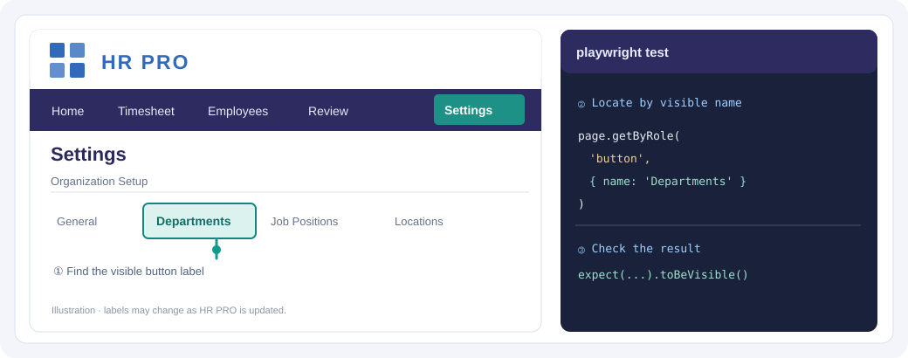

<p align="left"></p>

# HR PRO Automated Testing

This project uses **Playwright** to automatically check HR PRO in a browser. It can do the same steps a manual tester does—open pages, enter test data, click buttons—and then **check whether the result is correct**.

**[Open the HR PRO QA Guide](https://hr-pro-automation-help.vercel.app)** · **[Create a test with AI](https://hr-pro-automation-help.vercel.app/#ai)**

## Start here — run one test first

**[Open the visual step-by-step guide](https://hr-pro-automation-help.vercel.app/#beginner-start)**. It includes pictures, copyable commands, and a guided example. No prior coding needed to run an existing test.

1. Install [VS Code](https://code.visualstudio.com/), [Git](https://git-scm.com/), and [Node.js LTS](https://nodejs.org/).
2. Open **VS Code → Terminal → New Terminal** and enter:

```powershell
git clone https://github.com/nitsuwa/hr-pro-automation.git
cd hr-pro-automation
npm ci
npx playwright install chromium
```

3. Confirm the HR PRO test URL in `playwright.config.ts` or `E2E_BASE_URL` is an **approved non-production environment**, and you have an approved test account.
4. Open a single test in Playwright UI Mode:

```powershell
npx playwright test tests/smoke/navigation.spec.ts --grep "SMOKE-018" --ui --project=chromium
```

Click ▶ beside **SMOKE-018 | Settings opens successfully**. Review the browser and Actions panel. A green status means its checks passed, **not** that every part of HR PRO works.

**Then explore:** [Project folders](https://hr-pro-automation-help.vercel.app/#structure) · [Other test commands](https://hr-pro-automation-help.vercel.app/#commands) · [Verify results](https://hr-pro-automation-help.vercel.app/#verify) · [Understand syntax](https://hr-pro-automation-help.vercel.app/#syntax) · [Create with AI](https://hr-pro-automation-help.vercel.app/#ai).

## Where are the tests?

| Folder or file | What it's for |
| --- | --- |
| [`tests/smoke/`](tests/smoke/) | **Start here.** Login and navigation checks, such as `SMOKE-018` in [navigation.spec.ts](tests/smoke/navigation.spec.ts). |
| [`tests/regression/setup/`](tests/regression/setup/) | HR PRO Setup feature checks—Departments, Employees, allowances and more. Put **new Setup tests** here. |
| [`tests/infrastructure/`](tests/infrastructure/) | Advanced inspection scripts, **not routine regression tests**. |
| [`playwright/fixtures/`](playwright/fixtures/) | Reusable login/test setup. |
| [`playwright/pages/`](playwright/pages/) | Reusable actions and element locators. |
| [`package.json`](package.json) / [`playwright.config.ts`](playwright.config.ts) | Available commands, target URL and Playwright settings. |

**Need a quick command?** [Open the copy-and-paste command reference](https://hr-pro-automation-help.vercel.app/#commands).

**New test?** Create `tests/regression/setup/my-feature.spec.ts` for a Setup feature. [See the visual folder guide](https://hr-pro-automation-help.vercel.app/#structure).

## Other tests and new test creation

Use the [visual command guide](https://hr-pro-automation-help.vercel.app/#commands) to choose a test. Some Setup tests change records, so run those only against approved disposable QA environments with fictional data. Learn [test syntax](https://hr-pro-automation-help.vercel.app/#syntax), then use the [test creation walkthrough](https://hr-pro-automation-help.vercel.app/#create) to add an assertion and verify the result.

## What does a test actually check?

An **action** does something: `await button.click()`.

An **assertion** verifies the expected outcome: `await expect(row).toHaveCount(1)`.

**Passing** means the assertions succeeded—not necessarily that every part of the requirement was tested. Review the Playwright action timeline and expected result. [See how to verify results](https://hr-pro-automation-help.vercel.app/#verify).

## Want to create a test? AI can help.

Use the same process for an **Excel test case** or a **new feature not covered by Excel**:

**Requirement → Try HR PRO manually → Inspect buttons and fields → Ask AI for a draft → Add assertions → Run and verify → Pull request.**

[**Follow the guided AI-assisted test tutorial →**](https://hr-pro-automation-help.vercel.app/#create)



*Illustration: inspect the actual HR PRO control label, then use a Playwright locator and assertion. The [AI Help prompt](https://hr-pro-automation-help.vercel.app/#ai) shows what details to give ChatGPT or Claude.*

The guide includes a **copyable AI prompt**, a real Department test example, a new Employee Search example, and instructions for finding locators. You do not need to know TypeScript before starting.

AI suggests code; **the QA tester checks the real behavior**. Never send credentials or real employee data to AI.

**More reference:** [Written manual](docs/help/USER_MANUAL.md) · [QA execution records](docs/QA_EXECUTION_LOG.md)

## Sharing changes

Work on a new branch, run and review your test, then submit a **GitHub pull request** targeting `main`. The [documentation website](https://hr-pro-automation-help.vercel.app) updates when guide changes are merged to `main`.

**Official Playwright resources:** [UI Mode](https://playwright.dev/docs/test-ui-mode) · [Locators](https://playwright.dev/docs/locators) · [Assertions](https://playwright.dev/docs/test-assertions)
