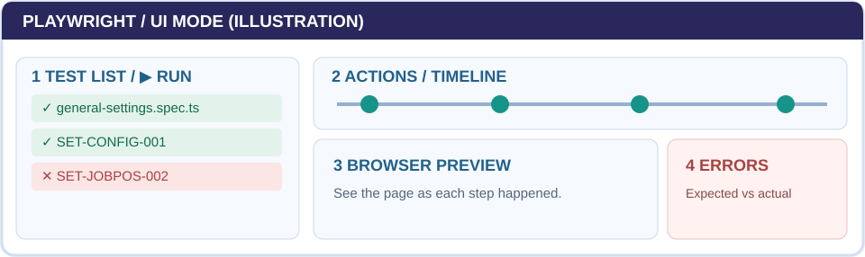

<p align="left"></p>

# HR PRO Automated Testing

This project uses **Playwright** to automatically check HR PRO in a browser. It can do the same steps a manual tester does—open pages, enter test data, click buttons—and then **check whether the result is correct**.

**[Open the step-by-step QA Guide](https://hr-pro-automation.netlify.app)** · **[Learn to create tests with AI](https://hr-pro-automation.netlify.app/#create)**

## Start here — run your first test

Install [Git](https://git-scm.com/), [Node.js](https://nodejs.org/), and [VS Code](https://code.visualstudio.com/). Ask for GitHub repository access and an approved HR PRO test environment.

Open VS Code → **Terminal → New Terminal**, then enter:

```powershell
git clone https://github.com/nitsuwa/hr-pro-automation.git
cd hr-pro-automation
npm ci
npx playwright install chromium
npm run test:ui:smoke
```

In Playwright UI Mode, open `navigation.spec.ts`, find **SMOKE-018 (Settings)**, and click **▶ Run**.



*Illustration: choose a test on the left; review actions and the browser preview on the right. [See the visual walkthrough](https://hr-pro-automation.netlify.app/#run).*

**Important:** Before running tests that create or change data, confirm `playwright.config.ts` or `E2E_BASE_URL` targets an **approved, non-production** HR PRO environment. Use fictional QA records only.

## What does a test actually check?

An **action** does something: `await button.click()`.

An **assertion** verifies the expected outcome: `await expect(row).toHaveCount(1)`.

**Passing** means the assertions succeeded—not necessarily that every part of the requirement was tested. Review the Playwright action timeline and expected result. [See how to verify results](https://hr-pro-automation.netlify.app/#verify).

## Want to create a test? AI can help.

Use the same process for an **Excel test case** or a **new feature not covered by Excel**:

**Requirement → Try HR PRO manually → Inspect buttons and fields → Ask AI for a draft → Add assertions → Run and verify → Pull request.**

[**Follow the guided AI-assisted test tutorial →**](https://hr-pro-automation.netlify.app/#create)

The guide includes a **copyable AI prompt**, a real Department test example, a new Employee Search example, and instructions for finding locators. You do not need to know TypeScript before starting.

AI suggests code; **the QA tester checks the real behavior**. Never send credentials or real employee data to AI.

## Where to find things

| Location | Purpose |
| --- | --- |
| [Documentation website](https://hr-pro-automation.netlify.app) | Step-by-step training for manual testers |
| [Playwright test scripts](tests/regression/setup/) | Examples and feature checks |
| [Smoke tests](tests/smoke/) | Basic navigation checks |
| [Shared helpers](playwright/) | Reusable logins and page actions |
| [Written reference](docs/help/USER_MANUAL.md) | Short companion guide |
| [Execution records](docs/QA_EXECUTION_LOG.md) | Detailed technical QA evidence |

## Sharing changes

Work on a new branch, run and review your test, then submit a **GitHub pull request** targeting `main`. The [documentation website](https://hr-pro-automation.netlify.app) updates when guide changes are merged to `main`.

**Official Playwright resources:** [UI Mode](https://playwright.dev/docs/test-ui-mode) · [Locators](https://playwright.dev/docs/locators) · [Assertions](https://playwright.dev/docs/test-assertions)
